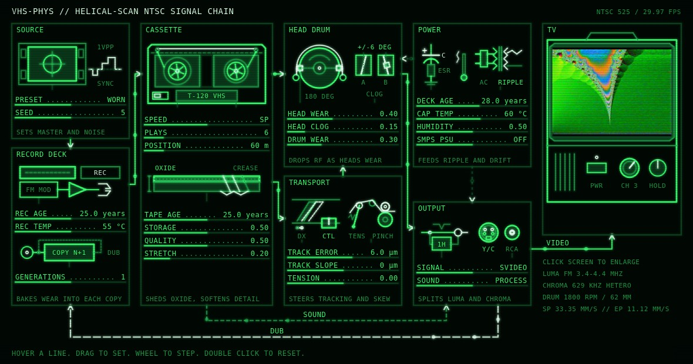
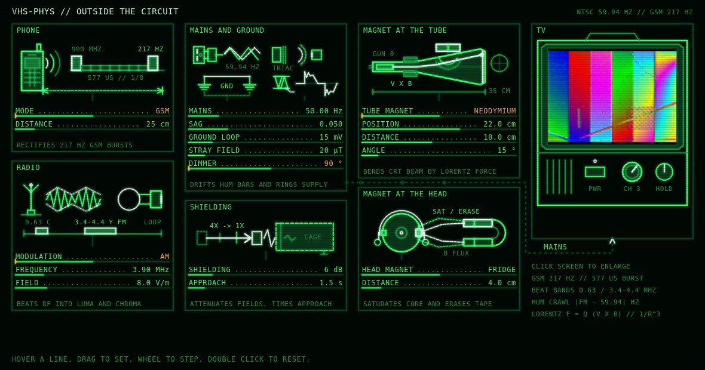
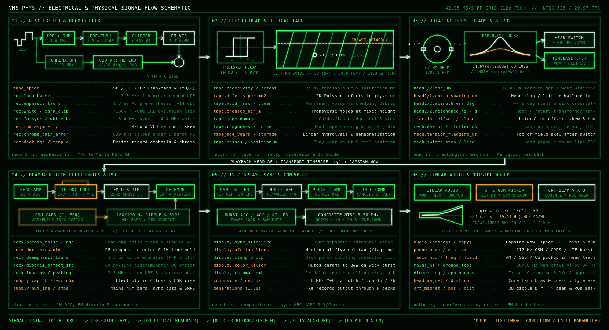
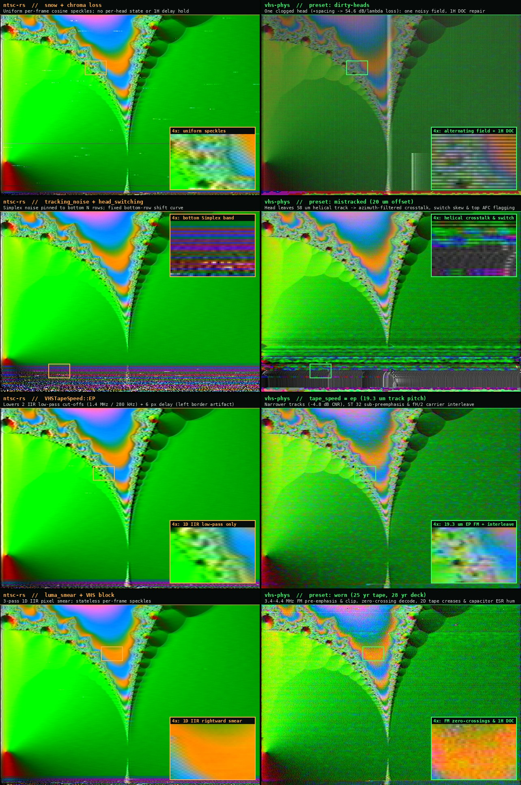
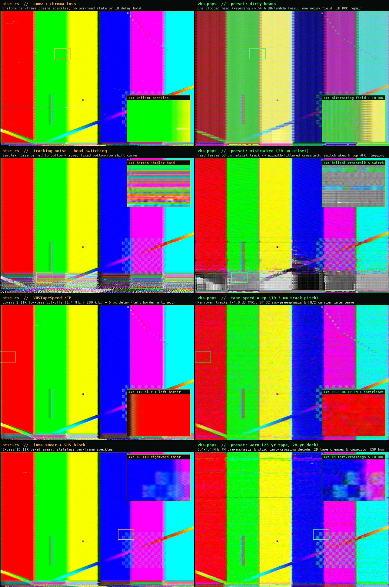

# vhs-phys

A VHS simulator that models the **physics** of the format instead of layering
filters and noise: a video is recorded as an FM signal onto a simulated tape,
read back through a simulated head with real head-to-tape spacing, passed
through simulated deck electronics, and decoded the way a TV does. Tape damage,
head wear, timebase errors and failing components then *emerge* from physical
parameters (spacing, coercivity, capacitor ESR, tape tension ...).


Left to right, top to bottom: source, pristine, good, worn, bad, ruined.

This is the standalone prototype. The Rust core (`vhsphys-core`) is written so it
can be wrapped as a plugin later (see `docs/PLUGIN.md`).

## Quick start

Requires a recent stable Rust and `ffmpeg`/`ffprobe` on the PATH.

```sh
cargo build --release
target/release/vhsphys presets
target/release/vhsphys run input.mp4 out.mp4 --preset worn
```

```sh
# a 10 second excerpt, different tape, fixed size, an extra fault on top
vhsphys run in.mkv out.mp4 --preset good --seed 12 --start 30 -t 10 --size 1280x720 \
    --set tape.creases_per_m=0.5 --set deck.supply.hum_ire=8

# a single still (the last frame processed)
vhsphys run in.mp4 still.png --preset bad --frames 40

# inspect / edit every parameter of a preset
vhsphys show worn --condition           # only the high-level knobs, as a config file ready for --config
vhsphys show worn > my_tape.toml        # edit, then:
vhsphys run in.mp4 out.mp4 --preset worn --config my_tape.toml
```

* The same `--seed` gives the same tape (same defects, same timebase wobble).
* `--start SECONDS` places the clip on the absolute timeline. The tape, its
  defects and the timebase error are functions of the absolute frame index, so
  an excerpt rendered with `--start` shows the same picture as the same frames
  of a render of the whole file. (Only the first frame of an excerpt differs a
  little, because it lacks the neighbouring frames the model looks at.)
* The picture is processed as NTSC by default (29.97 fps, 754x480 active picture);
  `--standard pal` makes it 625-line PAL (25 fps, 740x576), see
  [Television standards](#television-standards). ffmpeg scales to the standard's
  picture and back, so any input size/rate works. The linear audio track
  is processed alongside the picture (or copied untouched with `--audio copy`).
* About 11-14 frames per second on 8 cores (a 30 s 720p clip takes ~80 s; peak memory ~0.5 GB).

## Condition presets

`pristine`, `good`, `worn`, `bad`, `ruined`, single-fault presets
`dry-caps`, `dirty-heads`, `mistracked`, `stretched`, `humid-attic`, and presets that each
isolate one outside influence (see [Interference](#interference-the-outside-world)):
`phone-buzz`, `ham-radio`, `am-station`, `ground-loop`, `magnet-screen`, `magnet-head`, `dimmer`. A preset is a
`Condition` (tape age and storage, head wear/clog, deck age and temperature,
humidity, mains, tracking, tension ...) that the laws in
`crates/vhsphys-core/src/condition.rs` turn into physical parameters:

| Condition | becomes |
|---|---|
| deck age + temperature | electrolytic capacitor C and ESR (life halves per +10 C) -> supply ripple, regulator dropout, hum bars, SMPS herringbone |
| deck age + humidity | resistor drift -> emphasis network error, discriminator detuning, DC error |
| tape age, storage, quality, passes | oxide defect density and size, voids vs debris, creases, roughness, media noise, magnetic loss |
| tape speed | track pitch -> noise, crosstalk, tracking tolerance, audio bandwidth |
| head wear / clog | head half-width and spacing (Wallace loss), gain, azimuth error, one noisy field |
| drum / tension / stretch | timebase spectrum, flagging at the top, head-switch error, track bow and slope |
| tracking error | lateral head offset -> noise band, adjacent-track crosstalk |
| recording deck age | emphasis mismatch, chroma level, FM modulator asymmetry in what was *written* |

Any raw parameter can be overridden (`--set tape.defects_per_mm2=0.03`,
`--set head1.extra_spacing_um=0.9`, `--set hq=true`, `[tape]`/`[deck]`/... tables in a config
file). `[condition]` in a config file refines the preset before it is mapped.

## Television standards

`--standard` chooses the television system the tape is recorded and played in: `ntsc` (the
default), `pal` or `pal60`. In a config file it is a top-level `standard = "pal"` (above the
first table), and `--set standard=pal` does the same; the flag wins over both. An unknown name is
an error.

| | `ntsc` | `pal` | `pal60` |
|---|---|---|---|
| tape | 525 lines, 59.94 fields | 625 lines, 50 fields | 525 lines, 59.94 fields |
| television | NTSC | PAL | PAL |
| frame rate | 29.97 (30000/1001) | 25 | 29.97 (30000/1001) |
| active picture | 754x480 | 740x576 | 754x480 |
| tape speeds | SP, LP, EP | SP, LP | SP, LP, EP |

* `ntsc` is the model described in the rest of this file.
* `pal` is a 625-line recording played into a PAL television: another drum and tape speed, another
  colour-under carrier with the line-by-line V switch, a delay-line colour decoder, and the 50 Hz
  mains. The same tape condition costs more in PAL, because the head moves more slowly across the
  tape. `docs/PAL.md` has the figures and what is not modelled.
* `pal60` is an NTSC tape played on a multi-standard deck into a PAL television. The tape is
  exactly the NTSC one; only the television differs. A phase error that comes off the tape (head
  switching, timebase) still shows as a hue error, only averaged over two lines; one made in the
  television (`decode.tv_phase_deg`) costs saturation instead of hue, as it does in PAL. See
  "PAL-60" in `docs/PAL.md`.

The standard decides which of the two engines in the core runs, so it also decides what is
accepted: EP is refused in `pal` (the 625-line format has no EP), and composite output is
refused with a PAL television (`pal` and `pal60`), because the composite stage is an NTSC encoder
and decoder. Both are errors on standard error and a nonzero exit, from a config file and from
`--set` alike.

Everything else is the same in every standard. The output has the standard's frame rate whatever
the input's (a 25 fps clip rendered as `ntsc` comes out at 29.97 fps). `--start` and `-t` count
that standard's frames: `-t` is turned into a whole number of frame periods before it is given to
ffmpeg, so that the clip is exactly that many frames long. The sound is played through the same
tape and deck as the picture, so at PAL speed it is that tape's.

`vhsphys show worn --standard pal` prints the PAL parameters of a preset (they include
`standard`); with `--condition` it prints the condition of the preset on that engine, with the
`standard` line above `[condition]` so that the output works as a `--config` file.

The camera pickup tube ahead of the recorder works in every standard: `--camera-tube` takes `off`
(the default), `plumbicon`, `plumbicon-bias` or `plumbicon-act`, and `--iris-stops N` sets the
exposure in stops (positive overexposes, so highlights leave comet tails). The model is in
`docs/CAMERA.md`.

```sh
vhsphys run in.mp4 out.mp4 --preset worn --standard pal
vhsphys run in.mp4 out.mp4 --preset worn --standard pal --camera-tube plumbicon --iris-stops 2
```

## Graphical interface


A PySide6 desktop front end in `python/vhsgui` drives the `vhsphys` command line
tool. It requires the built binary (`cargo build --release`), `ffmpeg`/`ffprobe`
on the PATH, and `PySide6-Essentials`.

```sh
python3 -m venv .venv && .venv/bin/pip install -r python/requirements-gui.txt
scripts/vhsphys-gui [input-video]
```

`scripts/vhsphys-gui` runs `python -m vhsgui` inside the repository's virtual
environment. Options of `python -m vhsgui`:

* `input`: optional path to a video file.
* `--binary PATH`: path to the `vhsphys` executable (defaults to `$VHSPHYS_BIN`,
  then `target/release`, `target/debug`, then the PATH).
* `--screenshot PNG`: save a picture of the window and exit (works with
  `QT_QPA_PLATFORM=offscreen`).

The window presents condition settings on the left and a looped preview on the
right:

* **Settings**: choose the input video, preset, and seed; adjust the 20 condition
  controls across Tape, Heads and drum, Playback deck, Transport and tracking,
  and Recording deck ("Reset to preset" restores them); an Advanced box accepts
  raw TOML overrides (such as `[tape]` / `creases_per_m = 0.5`). The settings
  column scrolls while output controls (destination file, start, length, size,
  CRF quality, Render / Cancel, and progress) stay pinned below.
* **Preview**: choose a position and length (default 2 s, 0 for one frame) and
  press "Render preview". It renders the excerpt and loops playback; Original /
  Processed switches between source and result (key: O; Space plays/pauses).
  Because tape state is an absolute function of frame index, the preview matches
  the final output at that position.
* **Rendering**: writes to a hidden temporary file alongside the target and renames
  it on completion to avoid overwriting or corrupting existing files. Default
  output is `<input name>_vhs.mp4`.

### The schematic




The same controls can be shown as a phosphor-green electrical drawing: the **Schematic** button of the
mode bar replaces the settings column by a drawing of the deck, the cassette and the TV, every control
a labelled line with its value (drag a value, scroll over it, or click it and type). A second page,
**Outside**, draws the things that are not part of the circuit (see below). Both pages show the live
preview on the TV and edit the same settings as the panels, so the two views can never disagree.
`python -m vhsgui --schematic [--page outside] [--screenshot out.png] [input-video]`. The drawing
is data (`python/vhsgui/schematic/*/layout.json`, `glyphs.json`, format in `docs/design/FORMAT.md`,
design notes in `docs/design/SCHEMATIC.md`).

## Interference: the outside world

Things that are not in the circuit but act on it: a phone near the deck, a radio transmitter, the mains
(frequency, ground loop, stray field, a dimmer) and a magnet near the head drum or the picture tube.
Each is a *field at the equipment* (a dipole field, a free-space wave, the mains waveform) that a *coupling*
turns into a voltage at one node of the circuit (loop pick-up, rectification, induction, the Lorentz force);
the existing chain then reacts to it. Nothing is painted over the picture.

* a GSM phone is a 577 us burst every 4.615 ms; the amplifiers rectify it, so the sound buzzes at 217 Hz
  and the picture carries a band 9 lines tall every 72.6 lines; the buzz falls as the square of the distance;
* a radio carrier is induced in the head leads (a loop of 5 cm^2) and goes through the FM discriminator;
  near the luma carrier it makes a diagonal herringbone of fixed spatial frequency, near the colour-under
  carrier coloured stripes;
* the mains is a function of absolute time against the video's own 59.94 Hz, so hum bars crawl at the
  difference (a 50 Hz mains against NTSC video scrolls them fast); a ground loop modulates the video gain;
  a dimmer rings after every firing;
* a magnet saturates the head core and erases the tape (signal drops, the noise does not: snow); at the tube
  it bends the beam by the Lorentz force along its path (the raster shifts, warps, brightens where the lines
  crowd, and changes colour when a beam lands on the next phosphor stripe).

Conditions (`phone_mode`, `radio_mod`, `ground_loop_mv`, `crt_magnet`, ... ) are off by default and in every
older preset; with everything off the output is bit-identical to a build without the module. The derivations,
the equations and the list of estimated coefficients are in `docs/INTERFERENCE.md`.


Still frames show the picture side only: the phone's buzz, the mains hum and the dimmer's crackle are in the
sound, the hum bars and the dimmer marks move from frame to frame, and the single-sideband herringbone of
`ham-radio` comes and goes with the speech (a steady carrier, `radio_mod = "cw"`, holds it still).

## Tape speeds, generations, composite and sound

### Tape speed

Set in a config file (`[condition]` / `tape_speed = "lp"`), on the command line with `--set condition.tape_speed=lp`, or with the window's "Tape speed" menu (`sp`, `lp`, `ep`). Track pitch is 58 / 28.9 / 19.3 um; the extra noise, crosstalk and tighter tracking tolerance of LP and EP follow from the narrower tracks. LP and EP also follow the format's own record rules: one head's FM carrier sits half a line frequency above the other's, so adjacent-track crosstalk alternates from line to line and the display's comb cancels it, and the colour burst is not doubled at LP (details in `docs/TAPE_SPEEDS.md`).


### Generations

Set with `--generations N` (1 to 8, default 1) or in the window with "Generations". Each generation re-records the previous one's playback on a different tape and deck (its own seed), so defects, wear and timebase differ; the cost is N times. A seed given by `--set seed=N` or in the config file is the seed of the whole chain.


### Composite output

Off by default (S-Video style). Enable with `--set composite.enabled=true --set composite.decoder=notch|comb1h|comb2h` or with the window's "Signal" menu. The deck's Y/C is summed onto the NTSC subcarrier and separated again like a TV does: a notch leaks fine luma detail into colour (rainbow), a comb leaks vertical colour edges into luma (hanging dots), and the dot pattern crawls from frame to frame (details in `docs/COMPOSITE.md`).


### Sound

Set with `--audio process|copy|none` (default `process`; `copy` leaves the input audio as it was, `none` removes it) or in the window with "Sound" (previews never process sound). The linear audio track is simulated by the same tape and deck as the picture: wow and flutter come from the same capstan error as the picture's timebase, hum from the same supply ripple that makes hum bars, bandwidth from the tape speed (-3 dB at about 10 / 5 / 3.3 kHz at SP / LP / EP), hiss from tape and head noise (about 42 dB SNR on a good SP tape), and dropouts from the same defect statistics (details in `docs/AUDIO.md`). Hi-Fi audio is not modelled.

## What is physically modelled



```
frame -> NTSC raster (sync, burst, vsync, half-line field offset)
  -> record deck: luma bandwidth, 1.3 us emphasis, white/dark clip, FM 3.4-4.4 MHz,
                  FM high-pass, colour-under 629 kHz with +/-90 deg line rotation, burst x2
  -> record head/tape: saturating relay (coercivity) on FM + chroma current
                       -> two-state magnetisation, sub-sample reversal times;
                       chroma recorded as duty cycle of the FM bias
  -> tape: defect map in real tape coordinates (helical geometry), spacing field
  -> playback head: Lorentzian readback pulses (Karlqvist/reciprocity), width =
                    gap + transition + spacing, so Wallace's 54.6 d/lambda emerges;
                    azimuth loss and adjacent-track crosstalk; timebase warp
  -> head amp noise + head/transformer resonance (per head)
  -> head switch (6.5 H before vsync) between the two heads' signals
  -> deck: equaliser, slow RF AGC, dropout compensator (1 H recirculating delay),
           limiter + delay-line FM discriminator (exact, continuous time),
           de-emphasis, video low-pass, aperture corrector, supply ripple
  -> display: sync separator (tip referenced), AFC flywheel, back-porch clamp,
              burst APC/ACC/colour killer, 1 H comb for crosstalk
  -> optional composite stage: Y/C summed on the subcarrier and separated by a notch or comb
```

The sound takes the same transport, supply, tape and head parameters (see `docs/AUDIO.md`), and `--generations` chains several decks.

Research notes, parameter provenance and sources: `docs/RESEARCH.md`.
Architecture and numerical decisions: `docs/ARCHITECTURE.md`.
Comparison with other projects and roadmap: `docs/COMPARISON.md`,
`docs/PHYSICAL_MODELLING_RESEARCH.md`, and `docs/ROADMAP.md`.

## Comparison with filter chains (ntsc-rs)

[ntsc-rs](https://ntsc.rs/) is a fast, polished analog-video effect: a signal-processing chain on
YIQ fields that runs in real time and integrates cleanly with editing hosts. `vhs-phys` solves a
different problem: by recording a 42.95 MS/s FM signal onto a 2D helical tape and reading it back
through two physical heads and a deck, faults that are independent sliders in a filter chain emerge
together from one physical parameter.




From top to bottom in both comparisons (left: `ntsc-rs` with matched fault modules; right: `vhs-phys`):

1. **Clogged head (`dirty-heads` vs `snow` + `chroma_loss`)**: on a two-head helical drum, dirt on one
   head lifts it off the oxide (`+extra_spacing_um`), attenuating the 3.4-4.4 MHz FM carrier by
   Wallace's $54.6\,d/\lambda$ dB law on *every other field*. The clean head still reads its field
   normally, while the clogged field drops below the RF envelope threshold and triggers the deck's
   1H recirculating delay line (copying luma from the scanline above). A per-frame speckle pass sprays
   independent horizontal dashes across both fields alike.
2. **Mistracking (`mistracked` vs `tracking_noise` + `head_switching`)**: a 20 um lateral tracking
   offset moves both heads across the 58 um helical track boundary into the neighbouring field's
   track. Because the track slants across the tape, the envelope dip, azimuth-filtered crosstalk,
   head-switch phase jump (6.5 lines before vsync) and top-of-field AFC flagging follow the track
   geometry rather than sitting in a fixed Simplex-noise band at the bottom of the frame.
3. **EP / SLP speed (`tape_speed = ep` vs `VHSTapeSpeed::EP`)**: in `ntsc-rs`, switching to EP lowers
   two 1D IIR low-pass cut-offs (1.4 MHz luma, 280 kHz chroma) with a 6-pixel filter delay that
   leaves a dark vertical border on the left edge. In `vhs-phys`, EP narrows the helical track pitch
   from 58 um to 19.3 um (-4.8 dB carrier-to-noise ratio), applies IEC 60774-1 Table 4
   sub-preemphasis, and shifts Head A's FM carrier by $+f_H/2$ so adjacent-track crosstalk
   interleaves line by line.
4. **Worn tape & deck (`worn` vs `luma_smear` + `vhs_settings`)**: a 3-pass causal IIR pixel smear blurs
   high-contrast edges rightward in image space. In `vhs-phys`, edge ringing, white-clipping
   overshoot, zero-crossing FM noise, fixed-height tape creases and 120 Hz capacitor-ESR hum bars all
   come from the 3.4-4.4 MHz FM carrier, the 2D oxide map and the aged power supply.

See [`docs/COMPARISON.md`](docs/COMPARISON.md) for a full breakdown of where each tool is ahead.

## Validation

* 165 Rust tests (`cargo test --release`): carrier frequencies match the VHS
  standard, the discriminator is exact, the chroma duty-cycle recording gain
  matches theory, spacing loss follows 54.6 dB per wavelength, the azimuth
  filter follows the sinc law, adjacent tracks are line aligned, creases sit at a
  fixed picture height, point defects slide 1.5 lines per field, repeated playback
  cleans debris, component ageing follows the 10-degree rule, sessions are
  deterministic and reproducible from any start frame, tape speed geometry,
  composite separation, generations, audio bandwidth/wow/hum/dropouts; for the
  outside world: field laws with distance, GSM burst timing, hum bars crawling at
  the mains difference, dimmer marks at the firing times, a magnet's beam
  deflection integrated along the tube, and an unchanged picture with all
  sources off.
* Python lab (`python/`): checks the closed-form head physics against a full
  numerical Karlqvist integration, and measures the real CLI end to end.


```sh
python3 -m venv .venv && .venv/bin/pip install -r python/requirements.txt
cd python && ../.venv/bin/python -m pytest -q tests
../.venv/bin/python -m vhslab.report ../docs/img/validation.png ../target/release/vhsphys
```

## Known limits of this prototype

* NTSC, PAL and PAL-60 are modelled (see [Television standards](#television-standards)); SECAM and
  S-VHS are not.
* Input is treated as a progressive source (the two fields of a frame come from
  the same image); there is no 59.94 fps field output yet.
* Print-through and the luma line-delay noise canceller are not modelled.
* The ageing laws and several defaults are engineering estimates (tagged `[est]`
  in the source and notes) and are meant to be tuned against real tapes.

## Layout

```
crates/vhsphys-core   physics library (record, tape, head, mech, electronics, decode, pipeline)
crates/vhsphys-cli    `vhsphys` command line tool (ffmpeg pipes)
python/vhsgui         desktop front end (PySide6) for the command line tool
python/vhslab         reference physics, validation report, tuning and plotting tools
docs/                 RESEARCH, ARCHITECTURE, ROADMAP, PLUGIN, PERFORMANCE, COMPARISON,
                      PHYSICAL_MODELLING_RESEARCH, TAPE_SPEEDS, COMPOSITE, AUDIO, INTERFERENCE,
                      PAL, CAMERA, design/, images
scripts/gallery.sh    regenerate the gallery images
scripts/features.sh   regenerate the feature images
scripts/interference.sh  regenerate the interference images
```

## License

[PolyForm Noncommercial 1.0.0](LICENSE): free for any noncommercial purpose
(personal, research, hobby, education, nonprofit); commercial use needs a
separate licence from the author.

## Roadmap

See [`docs/ROADMAP.md`](docs/ROADMAP.md) for full notes and physics references.

### Currently being worked on
* **Composite PAL**: 4.43 MHz PAL composite path (PAL 1H/2H comb filter) for `pal` and `pal60` standards.
* **PAL deck tuning**: Playback equaliser and head resonance scaled to the PAL carrier; 58 um track pitch reference for CNR.
* **Camera tube limits**: Build-up lag, light-bias tail, target saturation fitting at 50 Hz, and blooming/burn-in models (`docs/CAMERA.md`).
* **Engine-generic audio I/O**: Generic CLI audio I/O across 525-line and 625-line engines and standard verification checks.
* **Schematic UI integration**: Television standard, camera tube selection, and conditional spec displays in the PySide6 schematic view.

### Near-term physical modelling
* **HQ non-linear noise reduction** (SP only): Diode limiter circuit on pre-emphasised signal with inverse filter on playback (`hq = true`). *(Completed)*
* **Magnetic recording beyond the relay**: Switching-field distribution / Preisach hysteresis ($M(H) = M_s \tanh((H \pm H_c)/\Delta H_c)$).
* **Head pole-tip contour ("head bumps")**: Edge flux coupling below 1 MHz affecting colour-under (629 kHz) and audio. *(Completed)*
* **Closed-loop chroma PLL**: Analog phase detector, loop filter, and burst-locked VCO for realistic unlock smear and head-switch phase jumps. *(Completed)*
* **True 59.94 / 50 fps field-sequential input**: Independent field-to-pass mapping for genuine moving interlace comb filtering. *(Completed)*
* **Hi-Fi depth-multiplex audio**: Dual FM audio carriers (1.3 / 1.7 MHz) with separate rotating head pair, switching buzz, and fallback muting. *(Completed)*

### Long-term goals
* **Parameter automation**: Time-varying keyframes and automation curves in the standalone app/CLI; per-frame parameter updates in preparation for plugin automation. *(Completed; mechanical crinkles planned)*
* **Cleaner UI**: Refined PySide6 desktop interface, grouped physical controls, dark schematic dock layout, and real-time parameter validation.
* **Walkthrough shell version**: Interactive terminal wizard (`vhsphys wizard`) to guide options without verbose command lines. *(Completed)*
* **Separate viewing window**: Detachable / floating preview viewport for multi-monitor workflows. *(Completed)*
* **Support button & easter eggs**: Period-authentic deck easter eggs (dew sensor trip, tape eject jam, retro OSD modes).

### Ultra-long-term goals
* **GPU compute architecture**: Compute shaders (WGPU / Vulkan / Metal / DirectX) for Lorentzian pulse rendering, delay-line discriminator, and RF filters to achieve real-time ($\ge 24$ fps) playback.
* **VFX and NLE plugins**: OpenFX (DaVinci Resolve, Nuke, Vegas), Adobe After Effects / Premiere Pro, and Blender compositor integration.
* **Cross-platform release binaries**: Automated CI builds for macOS (`x86_64` and `aarch64` Apple Silicon) and Windows (`x86_64`).
* **Android APK**: Mobile port using NDK and Vulkan compute for retro camera emulation and video processing.
* **Expanded media formats**: Analog formats (Betamax, Video8, Hi8, U-matic) and digital tape simulation (MiniDV / DVCAM macroblocking and dropouts).
* **Multi-generation bounce simulation**: Heterogeneous generational dubbing chains (e.g. Camera tube -> NTSC VHS -> Composite dub -> PAL deck -> CRT).
* **Real-world tape degradation datasets**: Community RF captures (`vhs-decode`) and measured deck responses to refine physical estimates.

## Support

[](https://ko-fi.com/T5F122USRI)
