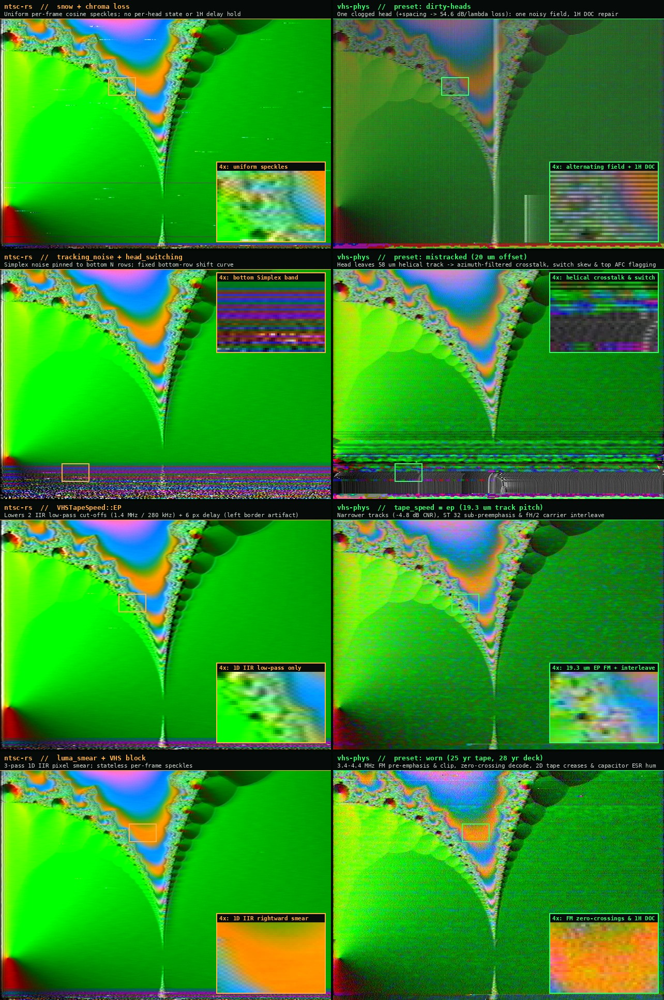
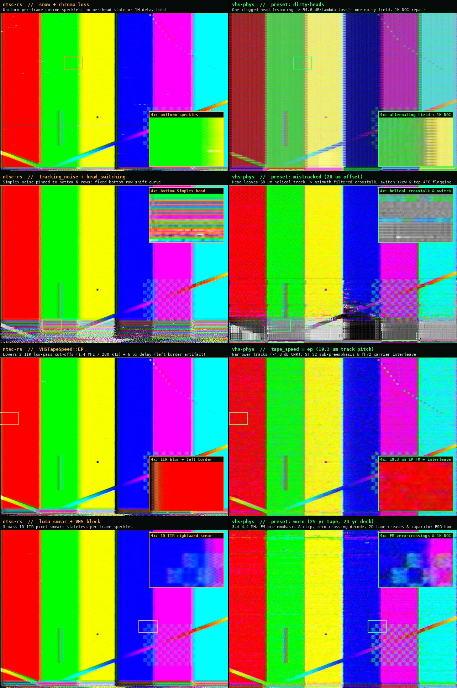

# vhs-phys and ntsc-rs

[ntsc-rs](https://ntsc.rs/) is a fast, polished analog-video effect: a Rust signal-processing chain
(about 19 passes on YIQ fields) that emulates composite NTSC and VHS-like artefacts, with a
standalone app, a web app, OpenFX and After Effects / Premiere plugins and a command line tool.
`vhs-phys` is a physical model of the tape, the heads and the deck. They solve different problems;
this page shows where each is ahead.

## Method

| | ntsc-rs | vhs-phys |
|---|---|---|
| What is modelled | composite encode/decode, noise, head switching, tracking noise, ringing, chroma errors, a small VHS block (edge wave, tape-speed low-pass, chroma loss, sharpen) | FM record, saturating tape, head readback with spacing, azimuth and tracking, a defect map in tape coordinates, deck electronics, TV-style decode, composite separation as an option |
| Controls | dozens of direct sliders (head-switching height, tracking-noise height, ...), JSON presets | 21 physical knobs (years, deg C, um) plus any raw parameter; look files |
| Origin | algorithms of composite-video-simulator, zhuker/ntsc and ntscQT | closed-form head physics, the VHS standard's figures, estimates tagged `[est]` |

## No pixel-space filtering

A filter chain works on decoded frames: blur kernels, shifted colour channels, noise laid over
the picture. vhs-phys has no 2D blur and no filter on a frame. Every process acts on the
one-dimensional signal in time, and the RGB frame is written once, when the picture tube model scans
the baseband (`crt::scan_to_frame`).

Horizontal softness has three physical sources:
1. Circuit bandwidth along the line: the record and playback low-passes leave about 3 MHz of luma
   and about 500 kHz of colour-under chroma. Vertical resolution is the raster's (525 or 625 lines),
   not a filter.
2. The head and the tape: each magnetisation reversal reads back as a Lorentzian pulse whose
   half-width grows with the gap, the transition length and the head-to-tape spacing; its spectrum
   is `exp(-k h)`, so spacing loss (Wallace's law) is a consequence of the pulse, not a separate
   filter.
3. The picture tube: the beam's landing position is computed from the fields at the tube and the
   baseband line is sampled there by cubic interpolation.

Ringing, smear and streaks are therefore the step responses of those circuits, not effects added
afterwards.

## Where vhs-phys is ahead

- **One cause, several symptoms.** A clogged head loses signal through spacing loss, trips the
  dropout compensator and gives one noisy field. Creases stay at one picture height; a point
  defect slides about 1.5 lines per field. In ntsc-rs head switching, tracking noise, snow and edge
  wave are independent effects.
- **Component ageing.** Capacitor ESR giving hum bars and supply herringbone, resistor drift
  detuning the emphasis and the discriminator, the dropout compensator repairing from the line
  above. Its settings list has none of these.
- **Sound.** The linear audio track shares the picture's physics: wow from the same capstan error,
  hum from the same supply ripple, bandwidth from the tape speed, dropouts from the same defect
  statistics. ntsc-rs has no audio (its FAQ points to the Chow Tape Model plugin). Hi-Fi audio is
  available as a simplified model (`audio.hifi`).
- **Tape speeds from geometry.** LP and EP are narrower tracks (28.9 and 19.3 um): the noise, the
  crosstalk and the tighter tracking tolerance follow. ntsc-rs lowers two low-pass cut-offs.
- **Dubbing.** `--generations N` re-records through a different deck and tape each time.
- **Checks.** Closed-form head physics against numerical integration, the VHS standard's numbers,
  a bit-exact guard on the plain path, and frozen acceptance tests for each model.

## Where ntsc-rs is ahead

- **Speed.** It runs in real time per its site, at resolutions well above NTSC; vhs-phys does
  about 12-14 fps at standard definition on 8 cores (`docs/PERFORMANCE.md`).
- **Integration and maturity.** Plugins for After Effects, Premiere and OpenFX hosts (Resolve,
  Hitfilm, Vegas), a web app, keyframing in hosts, an app with timeline, zoom and presets,
  releases for three platforms. vhs-phys is a command line tool and a window.
- **Composite coverage.** Six chroma demodulation filters (box, notch, 1-line, 2-line, 2D,
  adaptive 2D) and tunable composite settings; vhs-phys has notch and two combs.
- **Field handling and scale.** Upper, lower, both and interleaved field modes and a resolution
  scale; vhs-phys treats the input as progressive and works on a fixed 754x480 raster.
- **Direct artistic controls.** Asking for "head switching 12 lines tall" is one slider there;
  here it is a mechanical parameter.

## Neither has

- S-VHS.
- Validation against real captures of the format.

## Using both

They fit together: the tape and deck stage of vhs-phys could feed a composite stage, and a
physical front end could be a preset source for a plugin host. The comparison above is about
today's code; it will go out of date.
